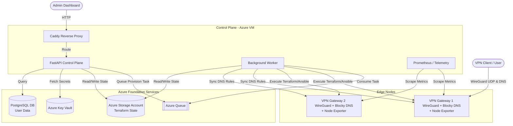

# VPN Infrastructure (VPN-infra)

This repository contains the Infrastructure as Code (IaC) and configuration management files for deploying and managing a scalable, multi-region Cloud VPN solution.

## Architecture Overview

The architecture is split into two primary layers: the **Foundation (Control Plane)** and the **Gateways (Edge Nodes)**.

## Architecture Diagram

The full, interactive architecture is documented in [**`VPN_architecture_V3.drawio`**](./VPN_architecture_V3.drawio), containing 3 comprehensive diagrams:

| Sheet | Title | Description |
| :--- | :--- | :--- |
| **1** | **Runtime Architecture** | Complete self-hosted WireGuard control plane on Azure, client clients (Android, Windows, Web, Operator), Docker container network (`caddy`, `api`, `worker`, `prometheus`), Azure Managed Services (`cloudvpn-rg`, Storage Account, Queue, Key Vault, Postgres), and multi-region VPN Edge Gateways. |
| **2** | **Repos & Release Pipeline** | Multi-repo layout across GitHub (`VPN-admin-dashboard`, `VPN-backend`, `VPN-infra`, `VPN-android`, `VPN-windows`) and master-branch CD deployments. |
| **3** | **Provisioning Job Lifecycle** | Asynchronous "receipt model" provisioning: Operator submission (`POST /servers`) &rarr; Azure Queue with visibility timeout &rarr; `terraform apply` (using Managed Identity / MSI) &rarr; Ansible over SSH &rarr; Gateway online notification & dynamic Prometheus discovery, with poison queue retry mechanics. |

> **How to open & edit the diagram:**
> - **In VS Code / Antigravity IDE**: Install the [Draw.io Integration extension](https://marketplace.visualstudio.com/items?itemName=hediet.vscode-drawio) and open [VPN_architecture_V3.drawio](./VPN_architecture_V3.drawio).
> - **In Browser**: Go to [app.diagrams.net](https://app.diagrams.net/), choose **Open Existing Diagram**, and select `VPN_architecture_V3.drawio`.

### Quick-View Diagram (Mermaid)

### 1. Foundation (Control Plane)

The foundation sets up the core management infrastructure required to orchestrate the VPN gateways, store states, and handle telemetry. The **Control Plane** is the central brain of this VPN infrastructure. It doesn't handle the actual VPN user traffic, but instead manages the lifecycle of the VPN gateways (creating/destroying them) and user access (adding/revoking users) via an asynchronous worker queue.

* **Terraform (`terraform/foundation`)**:
  * **Azure Resource Group & Network**: Core networking for the control plane.
  * **Azure Storage Account**: Acts as the central source of truth, storing the Terraform state and gateway initialization data.
  * **Azure PostgreSQL Flexible Server**: Database for storing user accounts, telemetry logs, and peer public keys.
  * **Azure Key Vault**: Securely manages secrets and keys for the control plane.
  * **Control Plane VM**: Hosts the backend APIs, the background worker, and the observability stack.
* **Services (`docker-compose.yml`)**:
  * **Caddy**: Reverse proxy that handles traffic routing to the backend and frontend.
  * **Prometheus**: Centralized observability stack that scrapes metrics from the VPN gateways (node metrics and WireGuard telemetry).
  * **Control Plane API & Worker**: A FastAPI control plane that pushes provisioning tasks (like creating a new VPN) to an **Azure Queue**. A separate background worker listens to this queue, runs the Terraform modules to provision the infrastructure, and executes Ansible to bootstrap WireGuard on the newly created edge nodes.

### 2. VPN Gateways (Edge Nodes)

Gateways are the actual VPN servers that clients connect to. They can be provisioned across different regions dynamically.

* **Terraform (`terraform/gateway`)**:
  * Provisions Azure VMs and required networking rules on-demand.
  * Exposes configuration variables for `vm_size`, `zone`, `region`, and `os_type`.
* **Configuration Management (`ansible/`)**:
  * **WireGuard Setup**: Bootstraps WireGuard on the freshly provisioned VMs.
  * **DNS Adblocking (Blocky)**: Each gateway runs an instance of **Blocky**, a lightweight DNS proxy and ad-blocker. WireGuard clients are automatically configured to use this local Blocky instance as their DNS resolver. The control plane worker dynamically pushes custom whitelists and blacklists to each gateway and triggers a hot-reload without dropping connections.
  * **Peer Management**: Ansible playbooks (`add_peer.yml`, `remove_peer.yml`) to dynamically add or revoke user access.
  * **Telemetry Sync**: Syncs WireGuard quota and usage stats back to the control plane.

### 3. CI/CD Pipeline

Continuous Integration and Deployment are handled via **GitHub Actions** (`.github/workflows/deploy.yml`):

* **Terraform Plan & Apply**: Automatically validates and applies changes to the foundation infrastructure on pushes to `main`.
* **Edge Deployment**: Uses SSH to connect to the Control Plane VM, pulls the latest configuration, restarts `docker-compose` services, and hot-reloads Caddy and Prometheus configurations.
